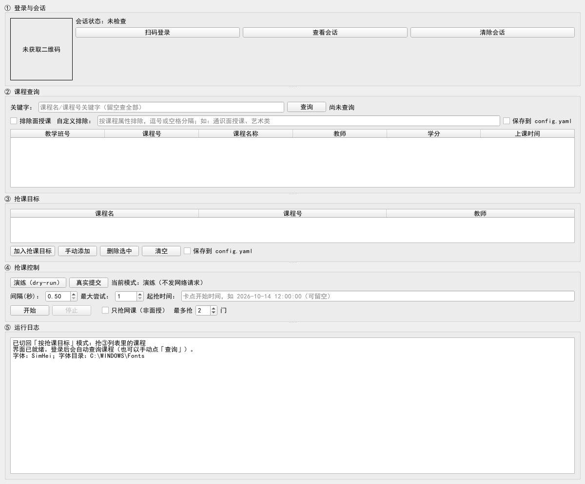
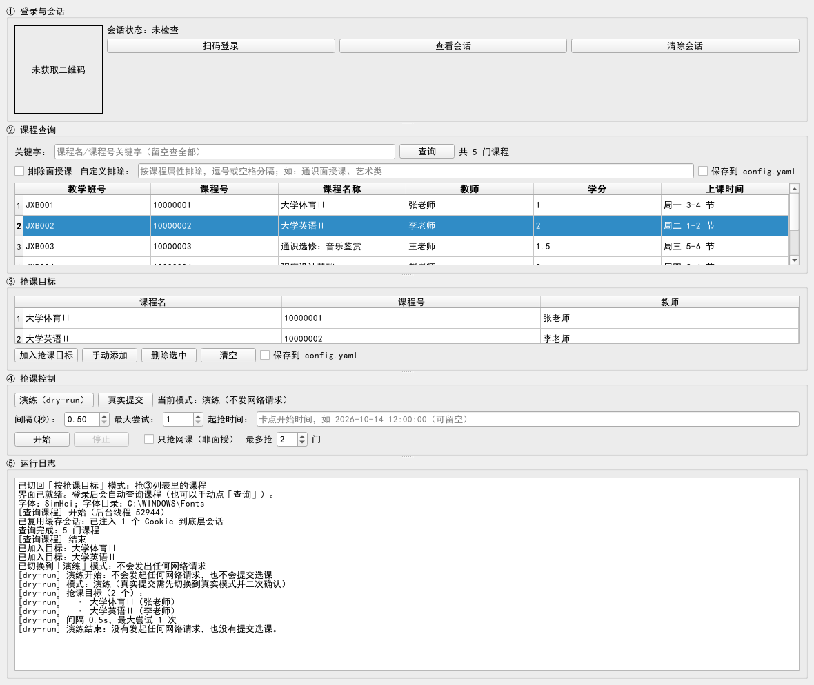
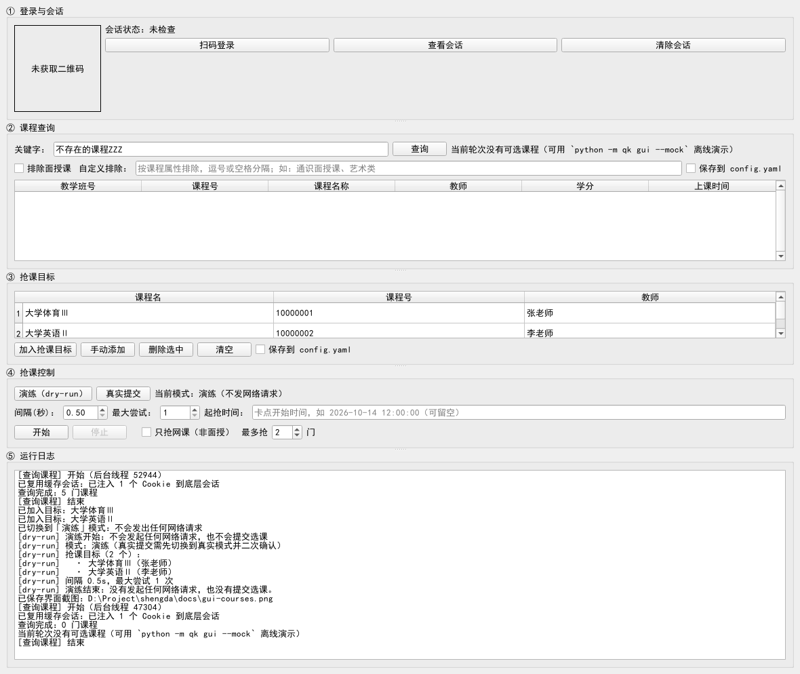

# qk —— 郑州升达经贸管理学院教务系统抢课工具

用 Python 写成，**同时提供命令行和图形界面**（GUI 见 [图形界面](#图形界面gui)），面向学校统一门户 <https://my.shengda.edu.cn/>。

> ⚠️ 请只用于自己的账号，并遵守学校教务系统的使用规定。脚本内置了请求间隔限速与
> 失败退避，请不要把间隔调成 0 —— 抢课期间把服务器打挂，谁都选不上课。
>
> ⚠️ **重要声明**：真实环境已部分实测——2026-10 在校园网下确认了统一认证的扫码登录链路
> （见「微信扫码登录」）与教务系统的选课契约（见「教务系统（Kingosoft）选课接口现状」）。
> 其中**查询候选课程**已实测可用；**提交选课/退课属于写操作，代码已按平台前端契约实现
> 但未在真实环境实测**，首次真实使用请按
> [校园网下首次联调步骤](#校园网下首次联调步骤) 逐步核对。项目自带离线 mock 教务服务，
> 全流程在 mock 上验证通过，但 **mock 通过 ≠ 真实接口已验证**。

---

## 目录

- [功能](#功能)
- [快速开始](#快速开始)
- [图形界面（GUI）](#图形界面gui)
- [配置](#配置)
- [命令](#命令)
- [接口现状](#接口现状)
- [当前实现适配范围](#当前实现适配范围)
- [如何用 mock 自测](#如何用-mock-自测)
- [校园网下首次联调步骤](#校园网下首次联调步骤)
- [出错了怎么办](#出错了怎么办)
- [设计要点](#设计要点)

---

## 功能

| 能力 | 说明 |
| --- | --- |
| 统一身份认证登录 | 走学校 CAS（`cas.shengda.edu.cn/lyuapServer`），自动处理 302 重定向与 ticket 校验 |
| **微信扫码登录** | `login --wechat`：在**终端直接画出二维码**，手机扫一扫即登录；扫码一次可把会话存下来，之后 `grab --use-session` 无需再扫 |
| 验证码两种情形 | 登录页**没有**验证码 → 自动登录；**有**验证码 → 明确报错并给出处理方式（填 `captcha_code`） |
| 候选课程查询 | 按课程名/课程号/教师筛选教学班；**容量/余量取决于学校的接口**：真实青果（Kingosoft）课程表**没有这两列**，此时表格里这两列为空、余量显示 `?`（不做任何猜测） |
| 定时抢课 | `grab.start_at` 支持 `2026-10-13 12:00:00` 或 `12:00:00`（今天，过期顺延到明天） |
| 失败重试与限速 | 请求间隔、指数退避重试、并发上限都可配置；容量满会按 `retry_interval` 继续重试 |
| 已选自动跳过 | 已在已选列表里的课程不再重复提交（报告状态 `SKIPPED_ALREADY_SELECTED`） |
| 会话过期自愈 | 会话失效（HTTP 401/403）时自动重新登录并重试该目标，最多 3 次 |
| 退课 | `drop_if_selected: true` 时先退掉已选课程再重选；退课失败会如实报 `DROP_FAILED` |
| 演练模式 | `--dry-run` 只打印计划，不联网、不提交 |
| 离线自测 | 自带 mock 教务服务（含容量满/已选/会话过期/退课失败等分支），无校园网也能验证全流程 |
| **图形界面** | `python -m qk gui` 或双击 `start-gui.bat`：窗口里扫码登录 → 查询课程 → 加目标 → 抢课，无需手改 YAML（PyQt6 可选依赖，见 [图形界面（GUI）](#图形界面gui)） |

## 快速开始

有**图形界面**和**命令行**两条路，选一条即可。不想记命令、不想手改 YAML 的，直接走第一条。

### 方式一：图形界面（推荐新用户）

```powershell
# 1. 安装依赖
python -m pip install -r requirements.txt

# 2. 图形界面需要额外装 PyQt6（可选依赖，只装一次）
python -m pip install -r requirements-gui.txt

# 3. 打开窗口
python -m qk gui
```

**或者更省事**：直接双击仓库根目录的 **`start-gui.bat`** —— 它会自己切到项目目录、
检查并在缺失时自动安装 PyQt6，然后开窗。参数照样透传：

```powershell
start-gui.bat --mock                     # 离线演示，不碰真实教务
start-gui.bat --config 我的配置.yaml      # 指定配置文件
```

界面分五块（登录与会话 / 课程查询 / 抢课目标 / 抢课控制 / 运行日志），对应命令行的
全部功能，详见 [图形界面（GUI）](#图形界面gui)。**扫码、加目标、抢课都能在窗口里完成，
不需要预先手改 `config.yaml`。**

### 方式二：命令行

```powershell
# 1. 安装依赖（requests、PyYAML）
python -m pip install -r requirements.txt

# 2. 生成本地配置
Copy-Item config.example.yaml config.yaml

# 3. 填学号，密码放进环境变量（避免明文落盘）
$env:QK_STUDENT_ID = "你的学号"
$env:QK_PASSWORD   = "你的密码"

# 4. 先演练，确认解析到的配置和抢课目标都对
python -m qk run --dry-run

# 5. 确认无误后正式运行
python -m qk run
```

## 配置

配置优先级：**内置默认值 → 配置文件 → `.env` 文件 → 环境变量**（后者覆盖前者）。

- 配置文件：默认自动查找工作区里的 `config.yaml` / `config.yml` / `config.toml`，也可用 `--config 路径` 指定。
- 环境变量：前缀 `QK_`，嵌套层级用双下划线，例如 `QK_HTTP__INTERVAL=0.5`、`QK_CAS__LOGIN_URL=...`。
- 常用扁平写法：`QK_STUDENT_ID`、`QK_PASSWORD`、`QK_CAPTCHA_CODE`。
- 凭据也可以放在 `.env` 文件里（`QK_STUDENT_ID=...`、`QK_PASSWORD=...`），用 `--dotenv 路径` 加载。

**凭据安全**：密码只从配置文件或环境变量读取，日志与终端输出一律脱敏为 `***`（Cookie 只显示名字、
URL 里的 `ticket` 参数也会被打码）；`config.yaml`、`.env` 已写入 `.gitignore`，不会被提交。

## 命令

```text
python -m qk run   [--dry-run] [--once] [--use-session]   # 登录 + 查询 + 抢课（一站式）
python -m qk login [--dry-run]                            # 账号密码登录，排查账号/网络/验证码问题
python -m qk login --wechat [--save-session] [--qr-file 路径] [--qr-mode auto|half|solid|ascii]
                                                          # 微信扫码登录（终端直接画二维码）
python -m qk list  [--course 名称] [--use-session]       # 列出候选课程（青果教务需 --use-session）
python -m qk grab  [--dry-run] [--once] [--start-at 时间] [--use-session] [--json]
python -m qk session [--info] [--clear]                   # 查看/清除本地会话缓存
python -m qk.mockserver --port 8899                       # 启动离线 mock 教务服务（自测用）
python -m qk --help                                       # 查看全部参数
```

公共参数：`--config 路径`、`--dotenv 路径`、`--workspace 目录`、`--json`、`--verbose`。

退出码：`0` 成功（含演练）· `1` 抢课目标未成功（**含目标因会话失效而失败**，如 `SESSION_EXPIRED`）· `2` 配置/凭据问题或未确认的配置项 · `3` 需要一个可用会话却没有（未登录/缓存会话过期/扫码失败）· `4` 其它错误 · `130` 用户中断。

> 实测提醒：真机上 `grab --use-session --once` 在「换教务 ticket 失败（TGT 已失效）」时，
> 该目标以 `SESSION_EXPIRED` 结束，命令退出码是 **1**（目标级失败），不是 3。
> 区分口径：**`grab`/`run` 的目标没成功 = 1**（含 `NO_MATCH`、`SESSION_EXPIRED`、被拒绝等）；
> **登录阶段就没拿到可用会话 = 3**（`run` 的登录失败、没有缓存会话时的 `EXIT_AUTH`）。

### 按授课形式排除课程（图形界面操作）

真实课程表的「课程属性」列形如 `经济管理类/通识面授课`，**后缀就是授课形式**。
实测（2026-10-13）本校通识选修课正选轮次的 117 门课**全部是「通识面授课」**，
想只看网络课/慕课等其它形式时，用「② 课程查询」里的过滤控件：

| 控件 | 作用 |
| --- | --- |
| ☑ **排除面授课** | 勾选即从结果里滤掉所有「面授课」，勾选/取消会**自动重新查询** |
| **自定义排除** | 按课程属性排除，分隔符支持中英文逗号/顿号/分号/空格；如 `通识面授课、艺术类` |
| ☐ **保存到 config.yaml** | 把当前排除条件写进配置文件，下次打开界面依然生效 |

对应的配置项（界面「保存到 config.yaml」写的就是它，一般不需要手改）：

```yaml
jwgl:
  exclude_course_attrs:
    - "面授课"
```

- 匹配规则：**子串匹配、大小写不敏感**，任一 pattern 命中即剔除；勾选框与自定义输入**合并生效**。
- **属性取不到的课程不会被排除**——避免字段缺失时静默清空列表；空串 pattern 也会被忽略
  （`validate()` 会直接拦住配置文件里的空串）。
- **保存是安全写入**：会先在内存里做「转储 → 重新加载」往返校验，校验不过就**中止**；
  写前把原文件备份为 `config.yaml.bak`；配置里没有 `jwgl` 小节时**拒绝写入**
  （否则该小节会覆盖内置默认值、把 `platform` 回落成 `auto`）。
  唯一注意点：PyYAML 会抹掉 YAML 注释，界面日志会明确提示并给出备份文件名。
- 这是**客户端过滤**：服务器仍返回全部课程，本项只裁剪展示与抢课目标匹配用的列表，
  **不改变发往服务器的请求，也不会让课程更容易选上**。
- 留空 = 不过滤（默认，保持既有行为）。

## 图形界面（GUI）

不想记命令、不想手动编辑 YAML 的话，用图形界面做同样的事：**扫码登录 → 查询课程 → 加入抢课目标 → 开始抢课**，整条链路都在窗口里完成。

### 安装与启动

```bash
python -m pip install PyQt6            # 或：python -m pip install -r requirements-gui.txt
python -m qk gui                       # 打开窗口
python -m qk gui --mock                # 离线演示：自动起内置 mock 教务服务，不碰真实教务
python -m qk gui --screenshot 图.png    # 离屏渲染一张窗口截图后退出（自检/取证用）
```

**不想敲命令？双击仓库根目录的 `start-gui.bat` 即可。** 它会自己 `cd` 到项目目录
（所以不受你当前所在目录影响）、检测 PyQt6 并在缺失时自动安装，然后开窗；
参数原样透传（`start-gui.bat --mock`、`start-gui.bat --config 我的配置.yaml`）。
该文件刻意只用 ASCII 字符——`.bat` 里的非 ASCII 文本会按控制台代码页解析，
曾导致 cmd 把中文注释当命令执行，所以请不要往里面加中文。

> **PyQt6 是可选依赖**：命令行功能（`run`/`login`/`list`/`grab`/`session`）**完全不依赖它**，
> 不装也能正常用。没装时运行 `python -m qk gui` 会打印可操作的安装提示并以**退出码 2** 结束，
> **不会抛堆栈**。
>
> **关于 `--mock`**：它会在本机起一个内置 mock 教务服务并把界面指向它（日志里会打印
> `离线演示模式：mock 服务已启动于 http://127.0.0.1:…`），适合先熟悉界面、不碰真实教务。
> ⚠️ 已知限制：内置 mock 的**青果课程表端点**声明 `charset=GBK` 却按 UTF-8 发送字节，
> 因此用它**查询课程**时，课程名/教师等中文可能显示成乱码（真实系统返回的确实是 GBK 字节，
> 所以对真实教务没有这个问题）。想看到中文正常的演示，用「通用契约（JSON）」的配置指向 mock
> 即可（本节的截图就是这样拍的）。

### 界面分五块，对应关系如下

| 界面区域 | 对应命令行 | 说明 |
| --- | --- | --- |
| ① 登录与会话 | `login --wechat --save-session`、`session --info`、`session --clear` | 二维码直接显示在窗口里；显示学号与过期时间；Cookie 值不显示。**扫码登录成功后会自动查询课程**（见下） |
| ② 课程查询 | `list [--course 名称]` | 表格列：教学班号 / 课程号 / 课程名称 / 教师 / 学分 / 上课时间。登录后自动查一次，也可随时手动点「查询」 |
| ③ 抢课目标 | `grab.targets`（config.yaml） | 课程表选中一行 →「加入抢课目标」；可增删清空；默认**只在内存**，勾选「保存到 config.yaml」才落盘 |
| ④ 抢课控制 | `grab` / `run`（含 `--start-at`） | 演练 / 真实提交、间隔、最大尝试次数、起抢时间、**只抢网课（非面授）**、最多抢几门、开始 / 停止 |
| ⑤ 运行日志 | 命令行的实时输出 | 只读，自动滚动；抢课过程中每个目标的结果都会打印 |

### 登录成功后自动查询

扫码登录成功后，② 课程查询会**自动拉一次**候选列表，不需要再手动点「查询」。
整个流程因此变成：

```
扫码登录  →（自动查询）→ 挑课加目标 或 直接勾「只抢网课」→ 开始
```

两条边界（都有测试守着）：

| 情形 | 行为 |
| --- | --- |
| 只是打开界面（会话是缓存的） | **不发请求** —— 避免开个窗口就产生网络流量；点「查询」或直接抢课即可 |
| 登录失败 | 不触发查询（没有会话，查了也是报错） |
| 用户随后手点「查询」或「开始」 | 挂起的自动查询**立即作废**，不与用户操作抢忙碌态 |
| 忙碌态迟迟不释放 | 最多重试 3 次（≈600ms）就放弃，并在日志里提示手动查询 |

> 为什么强调「可取消」：自动查询若卡在忙碌态上重试，会把用户紧接着点的「查询」或
> 「开始」静默吞掉（`is_busy()` 直接 return）。这是被
> `test_network_paths_run_off_main_thread` 抓出来的真实回归。

### 一键抢网课（推荐用法）

抢线上课时不必「先点查询 → 再挑课 → 再加目标」。在 ④ 勾上
**☑ 只抢网课（非面授）**，设好**最多抢 N 门**，点「开始」即可：

```
登录 → 自动查询课程 → 排除属性含「面授」的课 → 跳过已选中的 → 依次提交
```

细节：

| 项 | 行为 |
| --- | --- |
| 排除依据 | 课程属性（如 `经济管理类/通识面授课`）里是否含 **`面授`**；含则剔除 |
| 属性取不到的课 | **不排除** —— 宁可多试一门，也别因字段缺失漏掉线上课 |
| 已经「选中」的课 | 跳过（重复提交既无意义，又会触发写操作的频率限制） |
| 停止条件 | 达到**最多抢 N 门**；此时 `stop_on_success` 不生效（两者语义冲突） |
| ③ 的抢课目标 | 该模式下**被忽略**（改用自动查询的结果） |
| 没有线上课可抢时 | 报 `NO_MATCH（当前没有可抢的非面授（网课）课程）`，不会静默成功 |

对应配置项：

```yaml
grab:
  online_only: true     # 等价于勾上「只抢网课（非面授）」
  max_courses: 2        # 最多抢几门
```



> 上图由 `python -m qk gui --screenshot docs/gui-main.png`（离屏）直接产出，即刚打开时的样子：
> 五块区域齐备；课程表六列为 教学班号/课程号/课程名称/教师/学分/上课时间，**没有容量与余量列**。
>
> 本节三张截图都能**一条命令重放**（会用内置 mock 离线跑一遍并把图写回 `docs/`）：
>
> ```bash
> QT_QPA_PLATFORM=offscreen QK_WRITE_DOC_SHOTS=1 \
>   python -m pytest qk/tests/test_gui.py -q -k doc_screenshots
> ```
>
> （不设 `QK_WRITE_DOC_SHOTS` 时，该用例只把图写到临时目录，不会动仓库。）

查询出课程、加入目标并演练之后（`docs/gui-courses.png`）：



### 安全边界（和命令行完全一致）

- **演练（dry-run）零网络请求**：只打印计划，不联网、不提交，和 `python -m qk run --dry-run` 同口径；
- **真实提交必须二次确认**：点「开始」前会弹窗列出要提交的课程，只有点「确认提交」才会发出写请求，
  点「取消」则中止并在日志里如实写明「已取消：未发出写请求」；
- **目标默认不落盘**：不勾选「保存到 config.yaml」时只影响本次运行；
- **不提供退课入口**，也**不展示未确认的「已选列表」**（该接口在真实系统里尚未确认，界面不会假装有）；
- 所有网络操作都在**后台线程**执行，界面不会卡死，运行中随时可以点「停止」。

### 空结果是怎么回事

真实青果（Kingosoft）的课程表**没有容量与余量列**，所以界面里不显示这两列；
如果查询返回 0 门课，状态栏会如实提示（`docs/gui-empty.png`，本节第三张入库截图）：



```text
当前轮次没有可选课程（可用 `python -m qk gui --mock` 离线演示）
```

> 补充：`--help` 的口径——新增 `gui` 一行后，`python -m qk --help` 的**行数由 24 变为 25**，
> 其余 `run` / `login` / `list` / `grab` / `session` 五个子命令的用法与语义**不变**。

## 抢课操作（升达 · 青果 Kingosoft）

> 2026-10-13 在校园网实测。**读链路（查询课程）已实测可用**；**写链路（提交选课/退课）按平台前端契约实现并有离线用例覆盖，但在真实环境未实测**——原因见本节末尾「实测到哪一步」。

### 0. 一次性准备

```bash
python -m qk login --wechat --save-session     # 扫码一次，保存会话（8 小时有效）
```

`config.yaml` 里与青果教务相关的字段（`config.example.yaml` 已给出实测默认值，**无需手填路径**）：

```yaml
jwgl:
  platform: "kingosoft"                        # 选中青果适配器
  kingosoft_base_url: "https://jw.shengda.edu.cn:8090/"
  cas_service: "http://jw.shengda.edu.cn:8090/caslogin"   # 必须与浏览器一致（是 http）
  menucode: "S2020202"                         # 选课(按开课计划)
  course_list_table_id: "2568"
http:
  verify_tls: false                            # 教务主机是学校自签证书
credentials:
  student_id: "你的学号"                        # 查询与选课都要用
```

### 1. 先看有没有课

```bash
python -m qk list --use-session                # 复用扫码会话查询（青果教务必须带这个参数）
python -m qk list --use-session --course 体育    # 只看包含“体育”的课
```

输出为对齐表格（教学班号/课程号/课程名称/教师/学分/上课时间）。**青果的课程表没有容量与余量列**，
所以那两列为空、余量显示 `?`——这不是 bug，需要容量信息请以浏览器选课页为准。
若显示「（没有匹配的课程）」，说明**当前选课轮次/课程范围下没有可选课程**（见下节「实测到哪一步」）。

### 2. 演练（不联网、不提交）

```bash
python -m qk run --dry-run                     # 只打印计划：登什么号、抢哪些课、间隔多久
```

### 3. 正式抢课（会真的提交选课）

在 `config.yaml` 里写好目标：

```yaml
grab:
  targets:
    - course_name: "大学体育Ⅲ"                  # 课程名（模糊匹配）
      teacher: "李老师"                          # 可选：限定教师
  retry_interval: 1.5                          # 每次尝试间隔（秒），别调成 0
  max_attempts: 60
```

```bash
python -m qk grab --use-session                # 复用会话抢课（推荐：不用重新扫码）
python -m qk run  --use-session                # 等价的一站式流程（登录 + 查询 + 抢课）
python -m qk grab --use-session --once         # 只试一轮，失败即退出
```

想卡点开抢时间：`python -m qk grab --use-session --start-at "2026-10-14 12:00:00"`。

### 4. 会话过期怎么办

教务会话有服务端有效期。典型现象与处理：

| 现象 | 含义 | 处理 |
| --- | --- | --- |
| `已复用缓存会话：…；<时间> 过期` 之后正常查询 | 本地缓存仍在有效期 | 无需处理 |
| `换教务 ticket 失败（HTTP 500）`，响应体含 `TGT :TGT-…已失效` | **CAS 侧 TGT 已失效**（本地 Cookie 还在，但服务端不认） | 重新 `python -m qk login --wechat --save-session` 扫一次码 |
| 页面返回 515 字节「温馨提示：凭证已失效，请重新登录!」 | 教务会话过期 | 同上 |
| 页面返回 1098 字节「错误:无效访问请求」 | 缺菜单上下文（脚本会自动先取，一般不会遇到） | 重新运行；仍失败请附完整输出提 issue |

查会话状态：`python -m qk session --info`；清掉重来：`python -m qk session --clear`。

### 实测到哪一步（2026-10-13，校园网）

| 命令 | 结果 | 退出码 | 说明 |
| --- | --- | --- | --- |
| `python -m qk list --use-session` | **命令成功**，输出「已复用缓存会话…CASTGC」+「（没有匹配的课程）」 | `0` | 命令 stdout 只有这两行；「换票 → 建教务会话 → 菜单上下文 → 表单 POST `taglib/DataTable.jsp?tableId=2568&fre=1`」的响应细节（**HTTP 200 / `text/html;charset=GBK` / 真实 22 列表头 / 0 数据行**）是同一次会话内用只读探测脚本另外核实的，不是 `list` 打印的 |
| 只读探测（同会话） | 五个真实课程范围 `zxbnj`/`zxfjjx`/`zxggrx`/`fx`/`zxknj`，以及**重修选课**的 `tableId=10139`/`5929362` 逐个查询 | — | 全部 `HTTP 200`、**0 数据行** → 当前轮次该生在这些批次里都**没有可选课程**，故没有真实课程样本可展示（不等于全校无课） |
| `python -m qk grab --use-session --once` | **走到了「查询候选课程 → 匹配目标」**（本次由用户重新扫码后的新会话执行）；目标写成不可能匹配的名称（`不存在的课程ZZZ`）以确保零写请求 | `1` | 原始输出：`已复用缓存会话…` → `开始处理目标：不存在的课程ZZZ` → **`目标结果：NO_MATCH（候选列表里没有匹配的教学班…）`** → `统计：{'targets': 1, 'attempts': 0, 'success': 0, 'dry_run': False}`。**未发出任何选课写请求** |
| `python -m qk run --use-session --once` | 同上：**真的执行了查询与匹配** —— 复用会话登录成功 → `开始处理目标：不存在的课程ZZZ` → **`NO_MATCH`** | `1` | 原始输出含 `学号：20230001`、`说明：复用 2026-10-13 19:59:51 保存的会话`。注意：`run` **既能只查**（`run --dry-run` 只打印计划、零网络请求，见下一行），本次也**确实用 `--use-session --once` 跑到了匹配**；它没有发出写请求，是因为缺少下面两条前提，**不是**因为命令不能只查 |
| （更早一次，会话失效时）`grab`/`run --use-session` | 在**换教务 ticket**这一步就失败 | `1` / `3` | 当时 CAS 返回 `TGT :TGT-xxxxxx-…已失效`（本地 Cookie 仍在）；重新扫码后即恢复，见上一行的成功记录 |
| `python -m qk run --dry-run` | 只打印计划，零网络请求 | `0` | 与历史行为一致 |

**本轮实测到哪里**：两条命令都到达了「**查询候选课程 → 匹配目标**」这一步（`list` 退出码 `0`、
`grab`/`run` 退出码 `1` 且原因为 `NO_MATCH`），但**没有**到达「提交选课」。原因是两条**具体**限制
（而不是「接口未确认」）：

1. **当前轮次没有可选课程**——`按开课计划`的五个真实范围（`zxbnj`/`zxfjjx`/`zxggrx`/`fx`/`zxknj`）
   与`重修选课`的两个 `tableId`（`10139`/`5929362`）全部返回 0 数据行，因此**没有可匹配的目标**，
   命令如实报 `NO_MATCH`（「候选列表里没有匹配的教学班」）。
2. **安全边界**——真正提交会改变你的选课结果，按约定必须先取得你对**具体课程**的明确同意；
   本轮未获得该同意，因此没有用可匹配的真实课程名去跑。

**继续路径**：等下一次选课窗口开放（届时课程池非空），你把想选的**具体课程名**告诉程序（写进
`grab.targets`）并确认要提交，即可真正抢课；如果没有明确同意，就按上面的口径如实收口。

**离线绿灯能证明什么、不能证明什么**：「加密实现与平台前端 JS 逐条比对一致」证明的是**加密层**；
「mock 会解密客户端参数、校验 token 后才记录」证明的是**契约层**（双方按同一约定实现，故不能靠它
发现真实服务器的差异）。**mock 通过 ≠ 真实服务器接受该写请求**——真实提交仍需一次
「课程可用 + 用户同意」下的实测（见「继续路径」）。

## 微信扫码登录

学校统一认证**已启用**微信扫码（实测 `GET /lyuapServer/loginType` 返回 `isWeChat: "1"`），用法：

```powershell
# 1. 扫码登录（终端会直接画出二维码，用手机微信「扫一扫」）
python -m qk login --wechat

# 2. 推荐：扫码一次，把会话存下来（抢课那天不用人在场）
python -m qk login --wechat --save-session

# 3. 到点抢课时复用会话，不再需要扫码
python -m qk grab --use-session
python -m qk session --info          # 看会话还能用多久（只显示 Cookie 名字）
python -m qk session --clear         # 需要时可以清掉
```

**扫码流程**（与真实前端一致）：`GET /lyuapServer/weChat/CreateQRcode` 取二维码（返回
`{uuid, content}`，`content` 是 PNG 图片）→ 终端解码后画出来 → 每 1.5 秒
`POST /lyuapServer/weChat/wx/CheckScan`（JSON `{"state": uuid}`）轮询 → 扫码成功后服务端返回
账号凭据 → 用凭据建立 CAS 会话并（可选）落盘。

**终端画不出来怎么办**：脚本会按终端编码能力自动选择画法（UTF-8 用半块字符 `▀▄█`，
中文 Windows 控制台 cp936 改用实心块 `█`，纯 ASCII 终端用 `##`），并在宽度不足或图像模糊时给出提示。
如果仍然扫不出来，加 `--qr-file qr.png` 把二维码存成图片，用手机相册识别即可。

**失败时怎么办**（四类失败都会给出「可改用账号密码登录」的指引，退出码均为 `3`）：

| 情形 | 脚本行为 |
| --- | --- |
| 学校未启用扫码 | 明确提示 `isWeChat=0`，建议改用账号密码登录 |
| 二维码过期 | 提示重新取码，并**自动重取一次**；仍失败则退出 |
| 等待超时 | 提示超时；可用 `--timeout 秒` 调整等待时长（默认取 `cas.wechat.poll_timeout`） |
| 接口不可达 | 提示确认校园网/校内 VPN 环境后重试 |

> 会话缓存文件（默认 `qk_state.json`）已在 `.gitignore` 中排除；它需要保存 Cookie 名值对才能复用，
> 但**日志与终端只显示 Cookie 名字与有效期，从不输出值**。

### 前置条件与实测边界（重要）

- **需要手机扫一次**：扫码登录必须由你本人用手机微信扫终端上的二维码，脚本无法代替这一步。
  扫码后的会话默认缓存 **8 小时**（`session.max_age_hours`），这段时间内 `grab --use-session`
  可以反复复用，到点抢课不需要人在场；缓存过期后需要重新扫一次。
- **必须能连到校园网**（或校内 VPN）：`cas.shengda.edu.cn` 与 `my.shengda.edu.cn` 只在校园网内可达。
  实测可达性偶有波动（同一目标出现过超时后又成功），脚本对不可达会给出明确提示并建议重试。

| 环节 | 状态 | 说明 |
| --- | --- | --- |
| `loginType` / `CreateQRcode` / `CheckScan` 三个端点与形态 | **已实测** | 2026-10 对真实系统探测所得，见上文接口表 |
| 终端二维码的绘制（解码、模块对齐、三档降级） | **已实测可用** | 夹具 `qk/tests/data/real_qrcode_220.png` 是真实响应里的那张图；2026-10-12 真机扫码成功 |
| 扫码成功后的凭据字段名 | **已实测** | 真实 `CheckScan` 成功态返回 `userName` / `passWord` / `service` / `type`，与默认配置一致 |
| 用凭据建立会话 | **已实测（2026-10-12）** | 见下方「实测确认的建会话流程」 |
| 手机能否扫出终端二维码 | **已由用户确认** | 2026-10-12 用户用手机微信扫终端二维码，服务端返回「扫码成功」并建立会话 |

### 实测确认的建会话流程（2026-10-12）

真实生效的路径**不是**「登录页表单」，而是平台的 `/v1/tickets` 接口 + 网关 Cookie：

1. `POST https://cas.shengda.edu.cn/lyuapServer/v1/tickets`
   **表单编码**（不是 JSON），键名为**小写**的
   `username` / `password` / `service` / `loginType`（微信扫码为 `"3"`）。
   密码在 `loginType` 非空时是**明文**（只有 `loginType` 为空才需要 RSA 加密，本工具不用那条路）。
2. 响应里**同时**给出 `tgt` 与 `ticket`（实测字段名就是 `tgt`、`ticket`）。
3. **把 TGT 写成名为 `CASTGC` 的 Cookie**——这是平台前端自己的做法
   （`setCookie("CASTGC", tgt)`），网关凭它识别会话；**少了这一步，门户只会返回页面而不下发任何会话 Cookie**
   （实测：不写 CASTGC 时 `service?ticket=` 全部 200 且无 `Set-Cookie`）。
4. `GET https://my.shengda.edu.cn/?ticket=<ticket>` → 建立会话，实测拿到 `CASTGC` 会话 Cookie，
   会话探测通过。

> **登录页表单路径在本平台不可用**：`/lyuapServer/login` 返回的是 2493 字节的 SPA 外壳，
> 页面里没有任何 `<form>`/`<input>`，所以「提交账号密码到登录页」这条老路在这里必然失败。
> 工具默认的 `cas.establish_strategy` 仍保留 `auto`（先 REST、失败再试表单），但真实生效的是 REST。

实测记录（2026-10-12 22:44）：`python -m qk login --wechat --save-session` →
终端画出二维码（61 模块 / 65 列 × 31 行）→ 用户手机扫码 → 服务端「扫码成功」→
建立会话并打印**学号**与**会话 Cookie 名（只显名字）**→ 会话落盘 `qk_state.json`（8 小时有效期）。
随后 `python -m qk grab --use-session` 在真机上**不再扫码**即复用成功（日志「已复用缓存会话」「登录：已完成」）。

## 接口现状

**已确认**

- 登录走学校统一身份认证（CAS）。门户页面 `my_login.html` 中可见登出地址
  `https://cas.shengda.edu.cn/lyuapServer/logout?service=https://my.shengda.edu.cn/`，
  说明存在 `cas.shengda.edu.cn/lyuapServer` 这套 CAS 服务，登录成功后会带 ticket 跳回门户。
  默认配置里的 `cas.login_url` 即按此填写。

**未完全确认（重要）**

> 下表里「教务选课接口路径」一行已于 2026-10-13 实测确认；其余几项（登录表单字段、验证码等）
> 目前用不到——本校走微信扫码登录，会话由 CAS 票换取（见「微信扫码登录」），保留它们是为了
> 兼容账号密码登录场景。

| 项目 | 现状 | 脚本的行为 |
| --- | --- | --- |
| 登录表单字段名 | 未确认 | 默认 `username` / `password`，可在 `cas.username_field` / `cas.password_field` 改；同时自动带上页面里的隐藏字段（`lt`/`execution`/`_eventId` 等） |
| ticket 校验端点 | 未确认 | `cas.validate_url` **默认留空**，由 `cas.login_url` 推导（同主机、路径换成 `/validate`）；确认后可显式填写 |
| 登录页是否有验证码 | 未确认 | 有则报明确错误并提示填 `credentials.captcha_code`（或 `QK_CAPTCHA_CODE`） |
| 教务选课接口路径 | **已实测（2026-10-13，见下节）；青果适配器已实现并内置路径** | 本站 `jwgl.platform=kingosoft`（默认），四个 `*_path` **保持留空即正确**——青果契约已内置在 `KingosoftCourseAdapter` 里。仅当改用通用实现（`platform=auto/custom/qz`）时才需要填这四个字段；留空时通用实现报「教务接口尚未确认」，**不会猜测路径乱发请求** |
| 教务产品线 | **已坐实：金智/青果 Kingosoft**「高校教学综合管理服务平台」（页面标题与 `KINGOSOFT` 关键字），**不是**强智系 | 早期基于「公开检索指向强智」的假设已经推翻。`KingosoftCourseAdapter` 已按金智真实契约实现（含写操作参数加密），见下节；通用实现还保留强智风格的 JSON/HTML 表格解析，供 `platform=qz` 使用 |

### 教务系统（Kingosoft）选课接口现状（2026-10-13 真实校园网实测）

**真实基址与服务**：教务系统在 `https://jw.shengda.edu.cn:8090/`（`http://` 同端口会 302 到 https；
443/80 端口**不是**教务服务，探测时表现为连接被重置）。
CAS 单点登录的 `service` 为 `http://jw.shengda.edu.cn:8090/caslogin`。

| 环节 | 方法与路径 | 实测结果 |
| --- | --- | --- |
| 换教务 ticket | `POST https://cas.shengda.edu.cn/lyuapServer/v1/tickets/{CASTGC}`（表单 `service=`） | **HTTP 200，正文是纯文本 ticket**（`ST-…`），不是 JSON。依据是 CAS 登录页前端的 `goHome()`：有 `CASTGC` 就换票再跳转 |
| 建立教务会话 | `GET {service}?ticket=ST-…` | **HTTP 200**，最终落到 `https://jw.shengda.edu.cn:8090/frame/homes.html`，Cookie 变为 `CASTGC` + `JSESSIONID`；`SetMainInfo.jsp` 显示 `_loginid`/`_usertype=STU`/根菜单「学生服务」 |
| 菜单上下文（**前置条件**） | `POST /frame/normalusemenu/getBreadcrumbsInfoNew.action?menucode=S2020202` | 直接访问选课页会返回 1098 字节「错误:无效访问请求」；先取菜单上下文再访问才 200 |
| 选课页 | `GET /student/wsxk.zx.html`（menucode=`S2020202`） | **HTTP 200、31481 字节**（`选课(按开课计划)`）；另有 `重修选课`=`/student/wsxk.cxxk.jsp` |
| 选课上下文/时间窗口 | `GET /jw/common/getWsxkTimeRange.action?xktype=2` | **HTTP 200 JSON**，含 `xn=2026`、`xqM=0`、`kcfw`、`lcid`、`nj`、`zydm`、`yxbdm`、`qssj`、`jssj`、`lcmc`（实测为「通识选修课（正选）」）、`isValidTimerange` |
| **查询候选课程** | `POST /taglib/DataTable.jsp?tableId=2568&fre=1` | **HTTP 200、`text/html; charset=GBK`**，返回表格：列为 `课程/学分/总学时/课程类别/课程属性/上课班号/上课班级名称/选课方式/任课教师/投入选课币/购买教材/重修/选课状态/操作`，另有隐藏列 `kcdm`（课程代码）/`skbzdm`（上课班组代码）/`skbjdm`（上课班级代码）。参数取自上面的 `getWsxkTimeRange`（`xn`/`xq`/`xh`/`nj`/`zydm`/`yxbdm`/`_kcfw`/`lcid`/`initQry`…） |
| 快速选课列表 | `POST /taglib/DataTable.jsp?tableId=5929101&xn=…&xq_m=…&xh=…&kcdm=&skbjdm=&xktype=&kcfw=&isyxkc=false&lcid=` | 页面代码实测（未单独跑） |
| **提交选课** | `POST /jw/common/saveElectiveCourse.action` | 页面代码确认（`saveData()`）：表单序列化后去掉 `electiveCourseForm.` 前缀，再经 `getEncParams()` 处理——**参数是加密的**：向 `/frame/homepage?method=getTempDeskey` 取临时密钥 → DES 加密 → base64，并带 `md5(md5(params)+md5(timestamp))` 形式的 token。**未实测（写操作，需用户同意）** |
| 退课 | `POST /jw/common/cancelElectiveCourse.action` | 页面代码确认：参数 `electiveCourseForm.{xn,xq,xh,kcdm,skbjdm,skbzdm,lcid,xktype=2}`。**未实测（写操作）** |
| 已选/学分统计 | `GET /jw/common/getSelectLessonScoreKcsInfo.action`（`xn`/`xq_m`/`xh`） | 页面代码确认（学分/门数统计） |
| **已选列表** | **未确认** | 上面那个 `wsxk.zx_promt_yxkctj.jsp` 实测 200 但标题是「主修学分修读情况」，**不足以证明它就是已选清单**；`jwgl.selected_list_path` 因此仍留空，适配器的 `fetch_selected()` 返回空列表并注明未确认——**不猜端点** |
| 选课币 | `GET /jw/common/getSelectLessonPointsInfo.action`（`xn`/`xq_m`/`xh`） | 页面代码确认 |

**已探测但不适用（禁止当作任何路径默认值）**：`/jsxsd/**`（`/jsxsd/`、`/jsxsd/xsxk/xkList`、
`/jsxsd/framework/xsMain.jsp`、`/jsxsd/xtgl/index_initMenu.html` 等）——无教务会话时返回 **515 字节
「温馨提示：凭证已失效，请重新登录!」**，建立金智会话后同一批路径变成 **1098 字节「错误:无效访问请求」**，
说明它属于另一套产品线，与本校教务无关。`/jwglxt/**`、`/xk/**`、`/jw/**` 等 47 个前缀在门户网关下
均为 404/SPA 外壳或连接被重置。

**这些端点已内置**：`config.example.yaml` 的 `jwgl.platform` 默认就是 `kingosoft`，上表路径无需手工填写；
`jwgl.course_list_path` / `select_path` / `drop_path` / `selected_list_path` 四个旧字段对青果平台**留空即可**
（它们只服务通用实现 `platform=auto|custom|qz`）。注意：青果适配器里 `select_path`/`drop_path` 的取值是
「非空则用配置值、为空则用内置端点」，所以**填写这四个字段会覆盖青果内置端点**——除非确知要换端点，否则留空。

**容量与余量**：真实课程表只有「选课状态/上课班号/上课班级名称」等列，**没有容量与余量**，
因此青果适配器把 `capacity`/`enrolled` 置为 `None`（`qk list` 里这两列为空、余量显示 `?`），
不会用别的字段冒充——需要容量信息时请以浏览器里的选课页为准。

### 微信扫码登录接口（2026-10 对升达实测）

| 项目 | 实测结果 | 脚本用法 |
| --- | --- | --- |
| 是否启用 | `GET /lyuapServer/loginType` → `data.isWeChat: "1"`、`isWeChatOpenLogin: "0"`、`weChatAutoConfirm: "0"` | `check_available()` 会先确认再取码；`isWeChat=0` 时直接报错并建议用密码登录 |
| 取二维码 | `GET /lyuapServer/weChat/CreateQRcode`（**无参数**）→ **平铺** `{uuid, content}`，`content` 为 `data:image/png;base64,...`（实测 PNG 220×220 / 8bit / RGBA / 非隔行） | 解出图片后在终端绘制；`cas.wechat.qrcode_path` 可改 |
| 轮询扫码 | `POST /lyuapServer/weChat/wx/CheckScan`，JSON `{"state": uuid}`；等待态 `{"meta":{"success":false,"statusCode":500,"message":"未检测到用户登录"}}` | 默认每 1.5 秒一次，`poll_interval` / `poll_timeout` 可调 |
| 扫码成功后的凭据字段 | **未实测到**（来自同族平台前端代码：`data.{userName,passWord,service}`） | 字段名全部可配置（`user_name_field` 等），S3 真实扫码后回写默认值 |
| 建立会话 | **已实测**：`POST /v1/tickets`（表单编码、小写键、`loginType=3`）拿到 `tgt`+`ticket` → 把 TGT 写成 `CASTGC` Cookie → `GET service?ticket=…` | `cas.establish_strategy: auto`（默认，先 REST 再试表单）/ `rest` / `form`；本平台表单路径不可用，真实生效的是 REST（详见下文「实测确认的建会话流程」） |

## 提交选课的真实报文与现状（2026-10-14 更新）

### 提交参数的**真实格式**（金标准：一次成功提交的解密结果）

2026-10-14 21:38，在「通识选修课(退补选)」里用浏览器**成功选上** `01265731`
（页面「已选」由 12门/24.5学分 变为 **13门/25.5学分**）。把该次
`POST /jw/common/saveElectiveCourse.action` 的 `params` 用服务端下发的临时密钥解密，
得到 **34 个字段**的明文。本工具的 `_write_params()` 现已与之**逐字段一致**，
夹具固化在 `qk/tests/fixtures/kingosoft_submit_golden.txt`，
回归测试 `test_kingosoft_write_params_matches_golden` 会逐字段比对。

| 项 | 真实取值 | 说明 |
| --- | --- | --- |
| **字段名前缀** | **不带**前缀：`xn`、`kcdm`、`skbjdm`… | 表单 DOM 上确实有 `electiveCourseForm.`，但 `doPostSave` 里的 `replaceAll("electiveCourseForm.", "")` **在加密前就把它剥掉了**。照着 DOM 加前缀是错的 |
| **班号** | `skbjdm = 01265731-002` | 页面 `doConfirm()` 里 `j$("#skbjdm").val(skbjdm)` 后再提交 |
| `txt_skbjdm` | **空** | 它只是弹窗里的显示字段，提交时为空 |
| `xf` | `1.0` | 不是 `1` |
| `is_buy_book`/`is_cx`/`is_yxtj` | `0` / `0` / `1` | 不是空字符串；「上课班调剂」默认勾选 |
| `njzy` | `2024%7C0501` | 明文里就是 `%7C`（页面未解码） |
| `xfsx`/`mssx` | 字面量 `undefined` | 页面原样如此 |
| 其它必带 | `xxkckzfs`、`yxkzyfxxk`、`yxsjct`、`nj`、`zydm`、`kcmc`、`menucode_current` | 曾整体缺失 |

### 提交所需的请求头（同一份抓包快照）

```
Referer:          https://jw.shengda.edu.cn:8090/student/report/wsxk.zx_promt.jsp?params=…
Origin:           https://jw.shengda.edu.cn:8090
Content-Type:     application/x-www-form-urlencoded; charset=UTF-8
X-Requested-With: XMLHttpRequest
```

* **Referer 必须是选课弹窗**（用选课页会拿到 HTTP 200 + 0 字节的空响应）。
  适配器用 `_popup_url` 记住最近打开的弹窗 URL。
* `Content-Type` / `X-Requested-With` 与 jQuery `doAjax` 一致，适配器已照发。

> ⚠️ **更正**：先前文档把「空响应」归因于「URL 双斜杠」，**那是误判**。
> `f"{base}{path}"` 在 `_base()` 已去尾斜杠的情况下只产生一个斜杠；
> 当时看到的 `//jw.shengda…` 只是调试输出把 `https:` 截断了。

### 「不是本人」是**会话问题**，不是参数问题

提交曾长期返回：

```
{"status":"400","message":"当前选课操作的用户不是选课学生本人!"}
```

`xh` 与会话身份明明一致。**对照实验给出了答案**：把浏览器的 `JSESSIONID` 直接交给工具
（`tools/test_browser_session.py`），用**完全相同的参数**提交 → 该错误消失，变成限流/业务消息。

结论：**服务端把「当前学生」绑定在会话上**，而本工具「换票 + 菜单上下文」建出的会话缺这一步。
浏览器实际访问顺序里多出首页 / 下拉字典 / **选课页** 三次页面请求，
适配器已补上（`_warmup_pages()`）。

### 链路现状（**已端到端打通**）

| 环节 | 状态 |
| --- | --- |
| 建会话（换票 + 菜单上下文 + 预热页面） | ✅ 真实环境通过 |
| 查询课程 | ✅ 真实环境通过（89–117 门） |
| 按授课形式排除 | ✅ 真实环境通过 |
| 解析可选上课班级 | ✅ 真实环境通过（10/10 门） |
| **提交选课参数** | ✅ 与金标准逐字段一致（34 字段 0 差异） |
| **会话身份** | ✅ `_warmup_pages()` 修复后实测通过 |
| **选课（工具侧）** | ✅ 真实环境成功（浏览器内 `01265731` 选上，学分 12门/24.5→13门/25.5） |
| **退课（工具侧）** | ✅ **真实环境成功** —— 见下 |

**退课实测（2026-10-14 23:2x，工具直接提交）**：

```
退课参数（8 字段，无前缀）：
  xn=2026&xq=0&xh=20230001&kcdm=01261231&skbjdm=01261231-001&skbzdm=
  &lcid=35732179068578980275991&xktype=2

POST /jw/common/cancelElectiveCourse.action
→ {"status":"200","message":"操作成功!"}     ← 两门课都是这个结果

权威复核：25.5 学分/13 门  →  23.5 学分/11 门
```

### 选课与退课的参数**不一样**

| | 选课 | 退课 |
| --- | --- | --- |
| 端点 | `jw/common/saveElectiveCourse.action` | `jw/common/cancelElectiveCourse.action` |
| 字段数 | **34** | **8**（`xn` `xq` `xh` `kcdm` `skbjdm` `skbzdm` `lcid` `xktype`） |
| 前缀 | 不带 | 不带 |
| 实现 | `_write_params()` | `_drop_params()` |

两者都对应页面里那句 ``replaceAll("electiveCourseForm.", "")`` —— **加密前会剥掉前缀**。

> 写操作有**频率限制**：短时间内多次提交会得到
> `<title>错误:请求太过频繁</title>`（HTTP 200 的错误页，不是 429）。
> **单次提交不受影响** —— 实测单次提交均正常返回业务消息。**不要连点**，
> 并且把目标里**已经选上的课程去掉**（或设 `grab.drop_if_selected: true`），
> 否则工具会反复重复提交同一门课。

### 用 `tools/verify_submit.py` 做一次受控验证

```powershell
python tools\verify_submit.py --course 01261231 --dry-run   # 只解析班号，不提交
python tools\verify_submit.py --course 01261231             # 真提交一次 + 权威复核
```

判定**成功**必须同时满足（脚本会打印两行供核对）：

1. 服务端返回 `status:200`（或「已选过」这类业务消息，**不是**「不是本人」）
2. **已选学分数字增加**（`getSelectLessonScoreKcsInfo.action`）或已选列表出现该课

> 教训：曾因某个列表接口显示「选中 + 退选」就宣布成功，实际学分未变、用户界面也没有该课。
> **单一接口不足以判定成功。**

## 当前实现适配范围

- **登录层** `qk/adapters/cas.py`：CAS 2.0 风格的「登录页 → 表单提交（不自动跟随重定向）→
  解析 `Location` 里的 ticket → 校验端点 → 建立会话」；支持相对/绝对回跳地址；
  可选 `cas.test_login_path` 用于登录后再校验一次会话是否真的有效；另有
  `login_with_credentials()` 支持用外部凭据（扫码所得）建会话：实测生效的是
  `POST /v1/tickets`（表单编码 + 小写 `username`/`password` + `loginType`）配合 `CASTGC` Cookie，
  失败时按 `establish_strategy` 决定是否再试 HTML 表单（升达登录页是 SPA，表单路径无效）。
- **扫码层** `qk/adapters/wechat.py`：取码 → 轮询 → 拿凭据；`qk/adapters/qr_render.py`
  **纯标准库**解码服务端 PNG 并在终端绘制（按终端编码能力自动选半块/实心块/ASCII 三档）。
- **选课层** `qk/adapters/jwgl.py`：`GET 课程列表` / `POST 选课` / `POST 退课` /
  `GET 已选列表`；响应支持 JSON（`items`/`rows`/`data` 等包装）与 HTML 表格（按表头列名定位）；
  返回码映射见 `CODE_TO_OUTCOME`（`SUCCESS`/`FULL`/`ALREADY_SELECTED`/`NOT_FOUND`/`AUTH_REQUIRED`/
  `CONFLICT`/`RATE_LIMITED`/`DROP_FAIL`），未识别的码再用提示文本关键词兜底归类。
- **会话缓存** `qk/session_store.py`：Cookie 名值对 + 保存时间/有效期，原子落盘；供
  `grab --use-session` 复用（扫码一次、定时抢课不再需要人在场）。
- **不属于本适配范围**：需要滑块/短信/人脸等额外校验的登录流程；需要 ukey 插件的门户功能；
  微信开放平台扫码模式（`isWeChatOpenLogin=1`，本校实测为 0）；APP/钉钉/聚合认证扫码；
  选课的「志愿/抽签」模式（当前按“先到先得”的即时选课实现）。

### 新增接口 / 新平台适配的接入方式

平台差异全部关在 `qk/adapters/` 里，换学校或换平台不需要改核心逻辑：

1. `qk/adapters/base.py` 定义了 `LoginAdapter`（登录层）与 `CourseAdapter`（选课层）两个接口；
2. 新平台新增一个模块（如 `qk/adapters/xxx.py`）实现这两个接口；
3. 在 `qk/adapters/jwgl.py` 的 `build_course_adapter()` 里按 `jwgl.platform` 选择实现
   （现有 `kingosoft`（本校默认）/ `auto` / `custom` / `qz`）；新平台要把自己的标识加进这个分支，
   并同步 `JwglConfig.platform` 的注释与 `config.example.yaml`；
4. 在 `qk/mockserver.py` 里加对应端点/分支，并在 `qk/tests/` 补一份用假传输或 mock 驱动的离线单测；
5. 把新接口的确认情况补写到本节与上面的「接口现状」表。

## 如何用 mock 自测

本项目自带离线 mock 教务服务，**不需要校园网**即可验证完整链路（含异常分支）。

```powershell
# 1. 启动 mock（默认账号 20230001 / 密码 mock-pass）
python -m qk.mockserver --port 8899

# 可选：带异常分支的实例
python -m qk.mockserver --port 8898 --expire-on-select   # 第一次选课时会话失效
python -m qk.mockserver --port 8897 --captcha-required --captcha-code 8888  # 登录页要验证码
python -m qk.mockserver --port 8896 --login-type-is-wechat 0                # 学校未启用微信扫码
python -m qk.mockserver --port 8895 --qr-expire-rounds 1                    # 二维码立即过期
python -m qk.mockserver --port 8894 --qr-never-success                      # 一直等待（验证超时）
python -m qk.mockserver --port 8893 --no-rest-tickets                       # 禁用 REST，验证回退 HTML 表单

# 2. 把 config.yaml 的 jwgl.base_url / cas.* 指向 http://127.0.0.1:8899/
#    （接口路径示例见 qk/tests/conftest.py 的 MOCK_PATHS）
```

mock 也会模拟微信扫码：`GET /lyuapServer/loginType`（`isWeChat` 可参数化）、
`GET /lyuapServer/weChat/CreateQRcode`（返回与真实一致的 PNG data URI，图案由参数控制）、
`POST /lyuapServer/weChat/wx/CheckScan`（等待 N 次后成功 / 过期 / 永不成功）、
`POST /lyuapServer/v1/tickets` 与 `/v1/tickets/{TGT}`（签发 TGT/ST，回调时下发 JSESSIONID）。
所以 `login --wechat` 与 `grab --use-session` 整条链路都能离线跑通。

跑测试与版本信息：

```powershell
python -m pip install -r requirements-dev.txt
python -X utf8 -m pytest qk/tests/ -q
```

- 已验证环境：**Python 3.12.7 + pytest 8.3.4 + requests 2.34.2 + PyYAML 6.0.3**
- 当前结果：`306 passed`（全离线，不访问任何真实主机；`test_mock_tests_never_touch_real_hosts`
  会断言 mock 用例中不出现 `shengda.edu.cn`）。测试构成：
  - `qk/tests/test_config.py` / `test_net.py`：配置与脱敏、限速与重试
  - `qk/tests/test_adapters.py` / `test_grabber.py`：CAS 与教务适配、抢课编排
  - `qk/tests/test_qr_render.py`：二维码 PNG 解码、模块采样、三档终端渲染（含真实二维码回归夹具）
  - `qk/tests/test_wechat_adapter.py`：扫码协议（取码→轮询→建会话）与失败语义
  - `qk/tests/test_wechat_cli.py`：**mock 真跑命令行**——扫码成功、会话缓存与复用、四类扫码失败
  - `qk/tests/test_e2e_wechat.py`：独立端到端复验——自起 mock、自写配置、黑盒驱动 `main()`，
    跑通「取码 → 终端渲染 → 轮询 → 建会话 → 落盘 → 复用抢中」并覆盖未启用/过期/超时/不可达/
    缓存过期/无缓存，另含两条独立脱敏断言（终端输出无 Cookie 值、缓存脱敏视图无 Cookie 值）
  - `qk/tests/test_e2e.py`：13 项端到端用例，自己起 mock、自己写配置并直接调用 `main()`，
    覆盖登录 → 查询 → 定时抢课 → 抢中确认 → 重复选课自动跳过 → 退课，以及容量满、退课失败、
    会话过期重登、验证码三态、dry-run 不触网、接口路径未确认与缺凭据退出码
- 依赖版本锁定在 `requirements.txt`（运行）与 `requirements-dev.txt`（测试）

> 自检脚本 `tools/check_no_secrets.py` 会扫描交付物里的疑似凭据。它会**跳过整行且含中文的注释**
> （这类注释是对配置项的说明，例如「登录方式：password 表示账号密码」，会被弱模式误判成密钥）；
> ASCII 注释与所有代码行照常扫描。因此它的 `exit 0` 表示「没有 ASCII 凭据泄漏」，
> 此外脚本第 6 项还会做一次脱敏演练（Cookie 值、CAS 票据、密码都必须被打码）。

### 用 mock 覆盖的异常分支（对应命令行证据）

| 场景 | 做法 | 预期结果 |
| --- | --- | --- |
| 抢中 | 目标 `大学体育Ⅲ` | `SUCCESS`，退出码 0 |
| 容量满 → 重试 | 目标 `大学英语Ⅱ`（容量 60/已选 60），`max_attempts: 2` | 重试 2 次后 `FULL`，退出码 1 |
| 已选 → 跳过 | 目标 `程序设计基础`（初始已在已选列表） | `SKIPPED_ALREADY_SELECTED`，尝试 0 次 |
| 退课成功 → 重选 | `drop_if_selected: true` + 已选课程 | 日志「已退课」后 `SUCCESS` |
| 退课失败 | 目标 `创新创业基础`（mock 设为不允许退课）+ `drop_if_selected: true` | `DROP_FAILED` 并记录原因 |
| 会话过期 → 重登 | 用 8898 实例（首次选课失效） | 日志「重新登录（第 1 次）」后 `SUCCESS`，报告里 `relogins: 1` |
| 扫码登录成功 | 默认 mock + `login --wechat --save-session` | 终端出现二维码 → 轮询 → 「登录结果：成功」+ 学号 + Cookie 名 |
| 扫码后复用会话 | 接上一步 `grab --use-session` | 「已复用缓存会话」后 `SUCCESS`，全程不再扫码 |
| 未启用扫码 / 二维码过期 / 等待超时 / 接口不可达 | 分别用 `--login-type-is-wechat 0`、`--qr-expire-rounds 1`、`--qr-never-success`、指向空端口 | 均为退出码 3，且提示里都含「可改用账号密码登录」 |
| 验证码缺失/错误 | 用 8897 实例，不设或设错 `QK_CAPTCHA_CODE` | 明确中文提示 + 退出码 3 |
| 验证码正确 | 8897 实例 + `QK_CAPTCHA_CODE=8888` | 登录成功 |

## 校园网下首次联调步骤

> 请**逐条**执行，每步确认无误后再进行下一步。所有输出都可以直接发回来定位问题。

1. **确认网络**：连上校园网或校内 VPN，浏览器能打开 <https://my.shengda.edu.cn/>。
2. **抓登录页**：在浏览器按 F12 → Network，登录一次，把 `GET …/lyuapServer/login` 的
   **Request URL**、**表单字段名**、以及回跳后出现的 URL（是否带 `ticket=`）记下来。
   若登录页有验证码，记下验证码字段名。
3. **核对并填写 `config.yaml`**：
   - `cas.login_url` / `cas.service` / `cas.logout_url`：按第 2 步实际地址填；
   - `cas.username_field` / `cas.password_field`：按真实字段名填（默认 `username`/`password`）；
   - `cas.validate_url`：若第 2 步看到 ticket 是提交到某个 `validate`/`serviceValidate` 地址校验的，填它；否则留空。
4. **只测登录**：

   ```powershell
   python -m qk login
   ```

   成功时会打印学号与**会话 Cookie 的名字**（不含值）。需要验证码时按提示填 `QK_CAPTCHA_CODE` 后重试。
5. **确认选课接口路径**：在浏览器里进入选课页面，按 F12 → Network，分别做「查询可选课程」「选课」「退课」
   「查看已选」四个动作，把对应的请求路径（含查询串参数名）填进 `jwgl.course_list_path` / `select_path` /
   `drop_path` / `selected_list_path`。**仅在使用通用实现时（`platform=auto/custom/qz`）才需要这样做**；
   本站默认的 `platform=kingosoft` 用不到这四个字段——青果的路径已内置在适配器里，不需要也不应该手填。
   若是别的平台且风格与自带实现不同，把 `jwgl.platform` 设为 `custom` 并在适配器里加分支（见上一节）。
6. **看候选课程**：

   ```powershell
   python -m qk list --course 大学体育
   ```

   核对教学班号、容量、余量与网页上一致；不一致说明字段别名需要补充（把原始响应发回来即可）。
7. **演练抢课**：

   ```powershell
   python -m qk grab --dry-run
   python -m qk grab --once          # 只试一轮，确认参数与结果判定正确
   ```
8. **正式抢课**：确认无误后设置 `grab.start_at` 并运行 `python -m qk run`。

## 出错了怎么办

| 现象 | 处理 |
| --- | --- |
| `配置错误：配置文件不存在` | 用 `--config` 指定路径，或把 `config.example.yaml` 复制成 `config.yaml` |
| `配置错误：缺少密码` | 设置环境变量 `QK_PASSWORD`，或在配置文件的 `credentials.password` 填写 |
| `网络错误：…` | 教务系统一般只允许校园网/校内 VPN 访问，先确认网络环境 |
| `执行失败：登录页需要验证码…` | 按提示把验证码填进 `credentials.captcha_code` 或 `QK_CAPTCHA_CODE` |
| `执行失败：登录未通过：提交后仍停留在需要验证码的登录页…` | 验证码错误或已过期，重新获取后重试 |
| `执行失败：登录被拒绝：账号或密码不正确` | 核对学号/密码（密码优先取 `QK_PASSWORD`） |
| `教务接口尚未确认：… 需要配置 jwgl.xxx_path` | 仅出现在通用实现（`platform=auto/custom/qz`）：按 [校园网下首次联调步骤](#校园网下首次联调步骤) 第 5 步抓取真实路径后填入。**青果平台（`platform=kingosoft`，本校默认）无需填**：路径已内置 |
| `执行失败：会话反复失效…` | 会话被服务器提前作废，检查是否有别处登录挤掉会话，或调大 `http.interval` 降低请求频率 |
| **会话莫名变成「只有 JSESSIONID」** | 多半是有个 `--mock` 的 GUI 在跑：它会写**假会话**。检查 `qk_state.json` 的 `service_url` 是否指向 `127.0.0.1`。新代码已把 mock 会话隔离到 `qk_state.json.mock`，但**修复前启动的旧进程仍会污染真实文件** —— 彻底关掉所有 GUI 窗口再重开 |
| `收到空响应（HTTP 200 但正文 0 字节）` | **不是限流**（真限流会给 429）。写请求为空响应通常是 **Referer 不对**：提交必须带选课弹窗 URL（见「提交选课的真实报文与现状」） |
| `当前选课操作的用户不是选课学生本人!` | 提交格式或流程不符。用 `tools/capture_submit.py` 与浏览器真实提交做差量对比 |
| `未预期的错误：…` | 加 `--verbose` 重新运行，把堆栈信息发出来 |

## 设计要点

```text
qk/
  __main__.py      命令行入口（python -m qk）：参数解析、错误到退出码的映射
  cli.py           子命令接线：run / login / list / grab
  config.py        配置加载 / 环境变量覆盖 / 凭据脱敏
  models.py        领域模型（课程、选课结果、脱敏工具）
  net.py           会话封装（超时、限速、指数退避重试、并发上限、Cookie）
  adapters/
    base.py        登录层与选课层的抽象接口 + 异常类型
    cas.py         CAS 统一身份认证实现（含用外部凭据建会话的 REST / 表单两种策略）
    wechat.py      微信扫码登录（取码 → 轮询 → 拿凭据）
    qr_render.py   纯标准库：解码服务端二维码 PNG 并在终端绘制（三档降级）
    jwgl.py        教务选课接口实现
  grabber.py       抢课编排（起抢时间、候选匹配、重试、已选跳过、会话重登、结果归类）
  mockserver.py    离线 mock 教务服务（CAS + 扫码 + 选课/退课 + 异常分支）
  tests/           pytest 测试（全部离线，不访问网络）
    data/            测试夹具（真实服务端二维码 220x220 PNG，用于回归护栏）
    test_config.py   配置加载与优先级、环境变量覆盖、凭据脱敏
    test_net.py      限速、指数退避重试、并发上限、统计
    test_adapters.py CAS 登录请求序列、验证码分支、教务解析与选课/退课
    test_grabber.py  候选匹配、起抢时间、重试、已选跳过、会话重登
    test_qr_render.py 二维码 PNG 解码、模块采样、三档终端渲染
    test_wechat_adapter.py 扫码协议与四类失败语义
    test_wechat_cli.py     mock 真跑命令行：扫码、会话缓存与复用、失败退出码
    test_e2e_wechat.py     独立端到端复验：黑盒驱动 main() 跑通扫码全链与各异常分支
    test_e2e.py      端到端：自起 mock 并直接驱动命令行入口（python -m qk）
  session_store.py 会话缓存（扫码一次、定时抢课复用）
tools/
  check_no_secrets.py      交付前只读自检：凭据扫描 + 脱敏演练
  check_config_example.py  示例配置与实现的一致性体检
```

- **可测试性**：网络层接受可替换的 `transport` 与可注入的 `sleep`/`clock`，所以限速、重试、
  起抢时间等待、抢课全流程都能在无网络环境下断言。
- **不猜接口**：未确认的接口路径留空即报错，避免向真实服务器乱发请求；CAS 校验端点由
  `login_url` 推导而不是写死一个未确认的真实地址。
- **如实上报**：服务端回「已经选过」不会被记成「抢中」；退课没成功也不会谎报成「按配置跳过」。
- **脱敏优先**：`password`/`token`/`cookie`/`session`/`ticket` 之类的**叶子**键在打印与日志中一律打码，
  容器键（如 `cookies`）保持可读以便排错；URL 里的 `ticket` 参数也会被替换。
